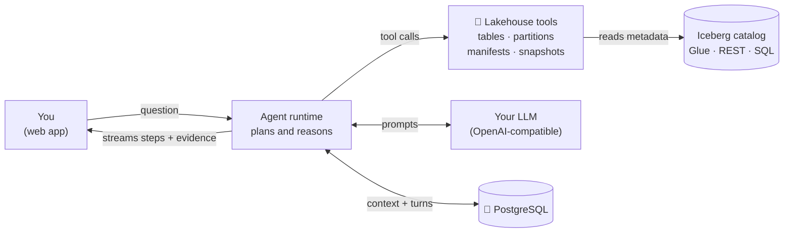

<p align="center">
  
</p>

<h1 align="center">LakeGen</h1>

<h3 align="center">Ask. Understand. Operate.</h3>

<p align="center">
  The AI agent for your Apache Iceberg™ lakehouse.
</p>

<p align="center">
  <a href="https://github.com/YOUR_USERNAME/lakegen/stargazers"></a>
  
  
  <a href="LICENSE"></a>
</p>

<p align="center">
  <a href="#-quick-start"><strong>Quick Start</strong></a> ·
  <a href="#-what-you-can-ask">What you can ask</a> ·
  <a href="#-how-it-works">How it works</a> ·
  <a href="#-roadmap">Roadmap</a> ·
  <a href="#-contributing">Contributing</a>
</p>

<p align="center">
  <video
    src="assets/videos/lakegen-demo.mp4"
    width="820"
    controls
    autoplay
    loop
    muted
    playsinline
  >
    <a href="assets/videos/lakegen-demo.mp4">Watch the LakeGen demo</a>
  </video>
</p>

Debugging an Iceberg table usually means six tabs of metadata queries.
LakeGen replaces that with one conversation: it investigates, explains what
it found, and suggests what to do next.

<p align="center">
  <strong>AWS Glue</strong> &nbsp;·&nbsp;
  <strong>Apache Iceberg™ REST</strong> &nbsp;·&nbsp;
  <strong>SQL-backed catalogs</strong>
</p>

> ⭐ If LakeGen saves you time, a star helps other data engineers find it.

---

## 🎬 LakeGen Demo


## The problem

Your lakehouse knows exactly why it's slow. It just can't tell you.

Iceberg tables get slow. Costs creep up. Nobody knows why. The evidence is
all there, buried in snapshots, manifests, and partition stats. Finding it
takes a dozen metadata queries and a lot of guessing, and the one person who
knows how is always busy.

LakeGen turns that investigation into a conversation. 👇

## ⚡ Quick Start

Run the complete stack in about 2 minutes.

**You'll need:** [Docker](https://docs.docker.com/get-docker/) and an OpenAI
or OpenAI-compatible API key.

**1. Configure inference**

```bash
cp .env.example .env
```

```dotenv
OPENAI_API_KEY=your-api-key
# OPENAI_BASE_URL=https://your-openai-compatible-endpoint/v1
OPENAI_MODEL=gpt-4o-mini
```

| Variable | Required | Description |
|---|---|---|
| `OPENAI_API_KEY` | Yes | API key used for inference. |
| `OPENAI_BASE_URL` | No | Custom OpenAI-compatible endpoint (OpenRouter, a proxy, or a self-hosted model server). |
| `OPENAI_MODEL` | No | Default model. Defaults to `gpt-4o-mini`. |

**2. Start LakeGen**

```bash
docker compose up -d
```

Docker starts PostgreSQL, the API, and the web app. Once the services are
healthy, open **[http://localhost:8080](http://localhost:8080)** and try:

> *"Which tables have a small-file problem?"*
> *"Why is `orders` slow?"*
> *"What changed in the last 24 hours?"*

Stop it with `docker compose down`. Your data stays in the
`lakegen_pg_data` Docker volume.

<details>
<summary><strong>Something not working?</strong></summary>

<br />

| Problem | Fix |
|---|---|
| Page won't load | Wait for healthy services: `docker compose ps` |
| Errors or empty answers | Check logs: `docker compose logs -f` |
| Model errors | Confirm `OPENAI_API_KEY`, `OPENAI_MODEL`, and `OPENAI_BASE_URL` in `.env`, then `docker compose up -d` again |

Still stuck? [Open an issue](https://github.com/YOUR_USERNAME/lakegen/issues).

</details>

## 🔎 What you can ask

| Ask this | LakeGen does this |
|---|---|
| *"Why is `orders` slow?"* | Examines files, manifests, and partitions, then explains the likely cause with evidence |
| *"Which tables have a small-file problem?"* | Surveys file layout across your tables and flags the outliers |
| *"What changed in the last 24 hours?"* | Walks snapshots and table history to show what changed and what came before |
| *"What's on the `audit` branch?"* | Inspects Iceberg references such as branches and tags |
| *"Pick up where we left off."* | Continues the investigation with context preserved across turns |

**Also built in**

-  **Iceberg-native tools:** reads tables, partitions, manifests, files, and snapshots directly, not just SQL results
-  **Streams live:** watch the agent investigate step by step
-  **Remembers context:** conversations and turns persist in PostgreSQL
-  **Bring your own model:** any OpenAI-compatible endpoint

##  Why not just use…?

| | **LakeGen** | Generic "chat with your data" | Catalog / dashboard UIs | DIY scripts & notebooks |
|---|---|---|---|---|
| Understands Iceberg internals (snapshots, manifests) | ✅ | ❌ SQL only | ⚠️ Partial | ✅ If you write it |
| Explains *why*, not just *what* | ✅ | ⚠️ | ❌ | ⚠️ Manual |
| Keeps context across a conversation | ✅ | ⚠️ | ❌ | ❌ |
| Streams its investigation live | ✅ | ⚠️ | ❌ | ❌ |
| Takes actions with approval | 🚧 Planned | ❌ | ⚠️ Limited | ✅ If you write it |
| Open source and self-hosted | ✅ | Varies | Varies | ✅ |

**Pick something else if** you only need dashboards on query metrics, or you
want a fully managed service with SLAs. LakeGen is for teams who run Iceberg
themselves and want answers without the archaeology.

##  Safe by design

LakeGen is built so you can point it at a real lakehouse without worrying.

-  **Read-only today:** the current release investigates and explains. It does not change your tables.
-  **Self-hosted:** runs in your environment, and conversations are stored in your own PostgreSQL.
- **You choose the model:** prompts and tool results go only to the endpoint you configure. Point it at a self-hosted OpenAI-compatible server to keep everything inside your network.
- **Least privilege:** we recommend read-only credentials for your catalog and storage.
- **Coming next:** write actions will be opt-in and gated behind explicit approval.

## How it works



1. **You ask** in the web app.
2. **The agent plans** and calls Iceberg-aware tools against your live catalog.
3. **You watch it work**, streamed step by step, with context saved for the next turn.

## 🗺️ Roadmap

**Shipped**
- [x] Read-only lakehouse investigation
- [x] Persistent conversational context
- [x] Streamed agent execution
- [x] PostgreSQL-backed catalog and turn persistence
- [x] AWS Glue, Iceberg REST, and SQL-backed catalog support

**Next**
- [ ] Approval-gated actions (compaction, snapshot expiry)
- [ ] Bundled sample warehouse for a zero-setup demo
- [ ] Scheduled health reports
- [ ] Plugin API for custom tools

** Ideas?** Vote with 👍 on [open feature requests](https://github.com/YOUR_USERNAME/lakegen/issues?q=label%3Aenhancement).

## 🤝 Contributing

LakeGen is built in the open, and contributions, bug reports, and design
proposals are welcome. To keep work coordinated, **every change starts with a
GitHub issue and maintainer approval** before implementation.

**Easy ways to start**
- Pick a [good first issue](https://github.com/YOUR_USERNAME/lakegen/issues?q=label%3A%22good+first+issue%22)
- Report a bug, even a small one
- Try it on your own lakehouse and tell us what broke
- Improve a doc or example

Read [CONTRIBUTING.md](CONTRIBUTING.md) for the full workflow.

<details>
<summary><strong>Run LakeGen locally with hot reload</strong></summary>

<br />

**Requirements:** Python 3.13+, [uv](https://docs.astral.sh/uv/), Node.js, npm,
PostgreSQL, and an inference API key.

1. Copy `.env.example` to `.env` and set `OPENAI_API_KEY` and `LAKEGEN_DATABASE_URL`.
2. Start the API from the repository root:

   ```bash
   uv sync
   uv run uvicorn lakegen.api.app:app --reload
   ```

3. Start the web app in a second terminal:

   ```bash
   cd apps/web
   npm install
   npm run dev
   ```

Open [http://localhost:5173](http://localhost:5173). The API runs at
[http://localhost:8000](http://localhost:8000), with health status at
[`/health`](http://localhost:8000/health). Vite proxies `/v1` and `/health`
to the API during development.

</details>

## 📄 License

LakeGen is available under the [MIT License](LICENSE).

---
